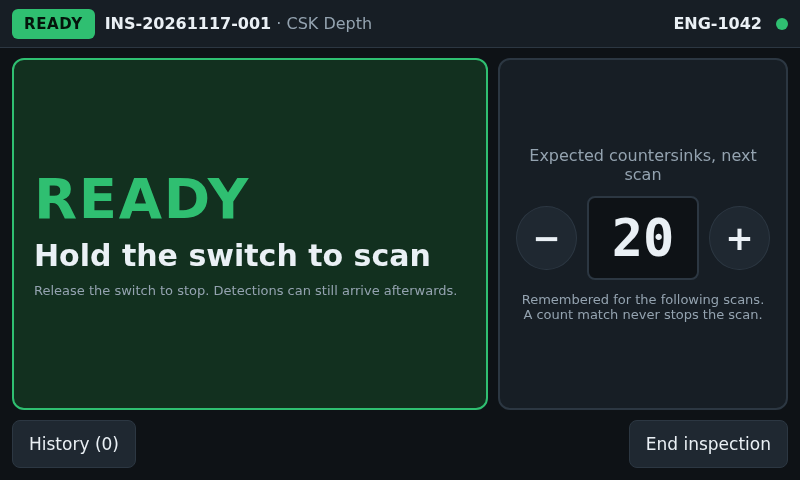
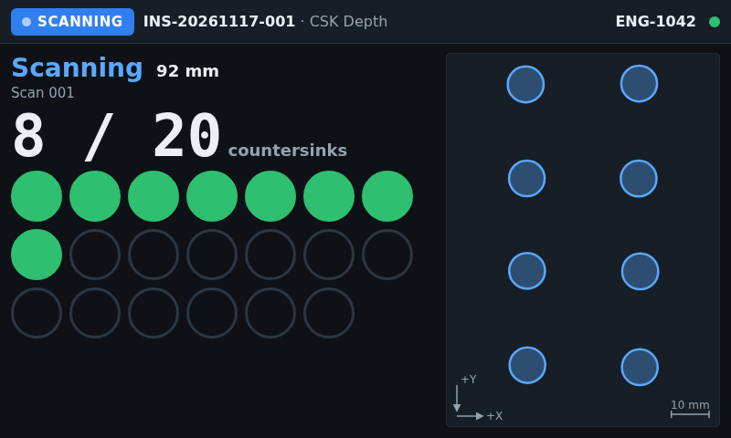
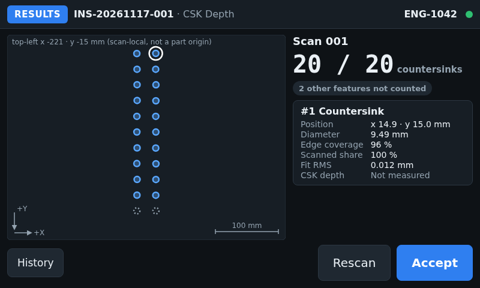
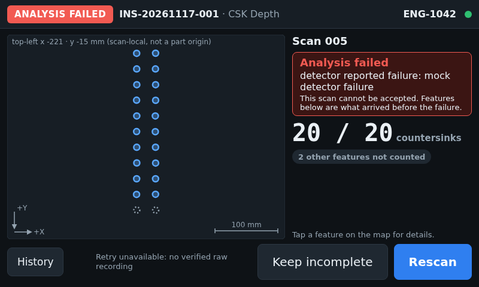
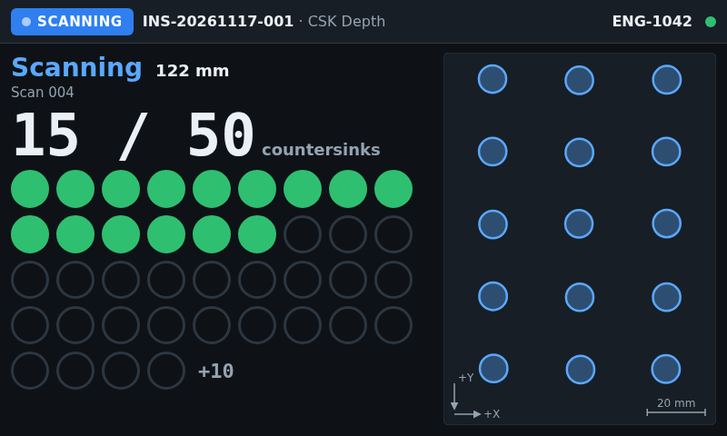
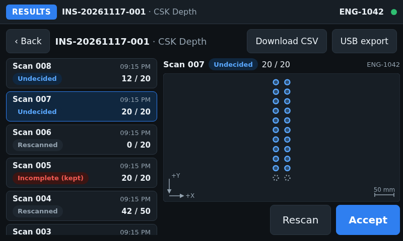
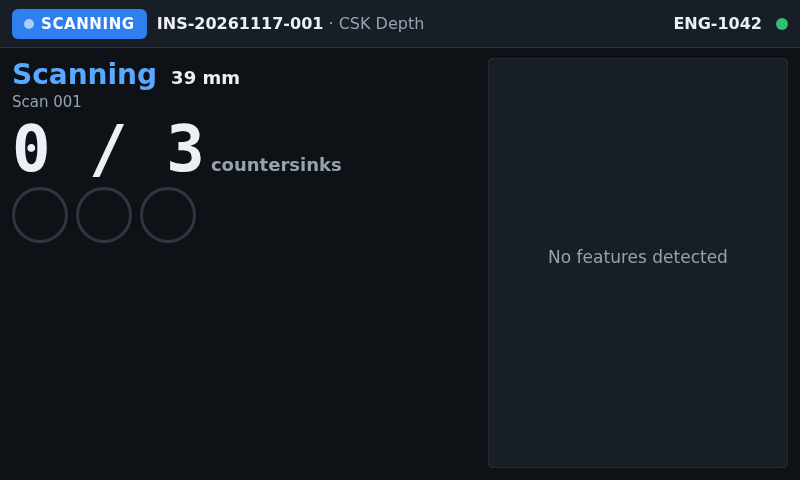
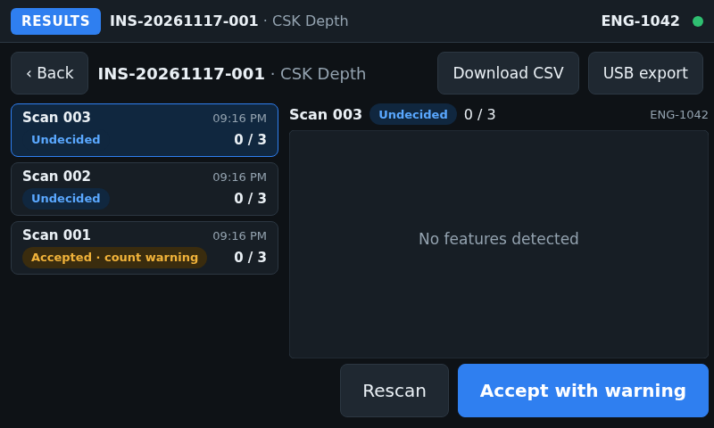

# Verifying Phase 4 yourself

Phase 4 = the operator screens at 800 × 480, plus CSV download and USB export. Plan exit: *all five screens
operate end-to-end on replay/mock data and live ROS input.* Bags and the Pi were not needed for this; they
stay open for Phase 0 and Phase 5.

## What was built

| Part | Where |
| --- | --- |
| Screens: Identification, Setup, Ready / Not ready, Scanning / Finishing analysis, Results / Analysis failed, History (+ past inspections) | [ui_web/src/screens](../../ui_web/src/screens) |
| Shell: state pill, inspection, *Time not verified*, operator, ⚠ alerts button, connection; offline notice; toast for refused commands | [App.tsx](../../ui_web/src/App.tsx), [Header.tsx](../../ui_web/src/ui/Header.tsx) |
| On-screen keyboard and keypad; count circles; SVG map; feature detail | [ui_web/src/ui](../../ui_web/src/ui) |
| Pure logic: map geometry (contract), circle layout, wording | [ui_web/src/lib](../../ui_web/src/lib) |
| Backend: `GET …/export.csv` (no side effects), `GET /exports/usb`, `POST …/exports/usb` (allowlisted, never overwrites, audited), `retry_available` on scans | [export.py](../../ui_backend/laser_hhrp_ui/export.py), [api.py](../../ui_backend/laser_hhrp_ui/api.py), [state.py](../../ui_backend/laser_hhrp_ui/state.py) |

No ROS node, message or detector changed in Phase 4.

## Checks (laptop, Humble, 2026-11-17)

| Check | Command | Result |
| --- | --- | --- |
| Screens in a real browser, mock source: every screen tapped through, layout rules on each, screenshots | `tools/ui_verify/phase4_screens.sh` | **118/118** |
| Screens in a real browser on **live ROS** (simulated core, real backend, supervised detector) | `HHRP_WS=… tools/ui_verify/phase4_live.sh` | **40/40** (+ SIGTERM leaves no detector) |
| Frontend tests | `cd ui_web && npm test` | **35/35** |
| Planted UI bugs | `python3 tools/ui_verify/web_mutation_check.py` | **15/15** caught, each by a behaviour test |
| Backend tests | `cd ui_backend && python3 -m pytest -q test/` | **118** passed (10 for Phase 4, 5 more after the review below) |
| Planted backend bugs | `python3 tools/ui_verify/mutation_check.py` | **32/32** caught (Phase 4: CSV completeness, USB allowlist / overwrite / audit, retry flag; review: 3 more) |

The browser checks drive headless Chromium-family browsers over the DevTools protocol (Brave on this laptop;
`BROWSER=chromium` on the Pi), with a throwaway profile, at exactly 800 × 480. They tap buttons the way a finger
does: nothing is clicked by calling JavaScript.

**Layout rules checked on every screen:** the page is exactly 800 × 480 with no scrolling; nothing is drawn
outside the screen; every touch target is at least 48 × 48 px; no label is clipped; no panel cuts off part of
its content. (The last rule was added after the first screenshots showed the feature detail cut off below
*Not measured*. Fixed.)

**What the mock run covers** (scenario, then what is checked):
- Operator ID typed on the on-screen keyboard; CSK inspection created by tapping.
- The first inspection has no remembered count, so it shows NOT READY "Enter the expected feature count". The
  keypad sets 20 and the − / + steppers change it.
- Scanning: 20 circles filling as detections arrive. Finishing analysis after release, with late detections
  still arriving.
- Results with all 20 countersinks, including those decided after release:
  - the map draws every feature, with +x rightward, +y downward and a uniform scale (measured from the drawn circles);
  - tapping a feature shows its details and *Not measured*;
  - Accept is recorded.
- 18 of 20: "2 fewer than expected" and **Accept with warning** (recorded as such).
- A short scan (the device lifted mid-part) shows the detector-flagged partial feature in amber.
- 50 expected: **40 circles + "+10"**. A dense 46-feature map.
- Detector failure: **no Accept**. "Retry unavailable" with the reason. Keep incomplete asks for confirmation.
- A zero-feature scan reads "Analysis complete: nothing found", not a failure.
- Fast next scan:
  - the earlier scan and the current one are both **Undecided**;
  - the earlier one is accepted later from History;
  - the USB dialog opens.
- Hardware NOT READY reasons (calibration, encoder). Warnings appear under the header, and the ⚠ button lists them all.
- End inspection (confirmed) → past inspections → inspection ID typed on the keyboard → a rivet inspection:
  - only the rivet detector is selected;
  - the expected count is remembered;
  - flushness shows *Not measured*.
- Browser reload while scanning: the same scan continues. Reload while analyzing: no duplicate features.
- No pass/fail wording on any results screen.
- The backend is stopped: OFFLINE and "this screen is not current".

**What the live ROS run covers:**
- Exactly one `hole_detector` starts from the Setup screen.
- NOT READY shows the live calibration reason, then READY after calibrating.
- `scan/start` → SCANNING with the live distance; `scan/stop` → Results from the detector's own finalization
  (364 frames, raw recording closed).
- Zero features are shown honestly (0 / 3).
- Two quick presses: Scan 002 stays **Undecided** and is decided later from History.
- Reload while scanning keeps the same scan.
- Ending the inspection and starting a rivet inspection from the screens leaves **exactly one
  `rivet_detector`**, and `hole_detector` is gone.

## Screenshots

All at 800 × 480 from the runs above: [screens/](screens/). Mock: `01`–`23`. Live ROS: `live-01`–`live-06`.

| | |
| --- | --- |
|  |  |
|  |  |
|  |  |
|  |  |

## Decisions worth knowing

- **History is the only local navigation.** Everything else follows `snapshot.screen`. A physical scan start
  closes History and shows Scanning.
- **Retry Analysis** appears only when `retry_available` is true (verified raw data *and* a replay path).
  Replay is not implemented, so v0.1 always shows "Retry unavailable: …" with the reason.
- **Accept on a count mismatch** is labelled *Accept with warning* without an extra confirmation dialog: the
  plan says a mismatch warns but does not block. *Keep incomplete* and *End inspection* do ask first.
- **USB export** lists only mounted drives below `/media` and `/run/media` (`--usb-root` to change). The
  operator picks one and confirms. The file is `<inspection label>.csv`, or `-2`, `-3` … if it already exists.
- **The detector mode cannot be changed** from Ready, by design: End inspection, then start a new one.
- Times are shown in the browser's local time and marked `?` when the clock was not verified when they were
  recorded.

## Code review of 78004e1 (2026-11-18)

External review of Phases 3 and 4. Each finding was checked against the code first; all were real.

| Finding | Fix | Regression test (fails on the old code) |
| --- | --- | --- |
| P2 conflicting terminal messages ignored or only audited | identical redelivery ignored; a different second `ScanStreamClosed` / `DetectionFinalized` fails a pending analysis; after the analysis is closed the scan is not rewritten, an alert is raised | `test_conflicting_terminal_message_fails_identical_is_ignored`, `test_conflicting_terminal_message_after_completion_alerts` |
| P2 a delayed controller stop arrived too late | an `UNCONFIRMED` stop keeps the analysis pending until the controller's stop or the 120 s watchdog ("stop not confirmed") | `test_controller_stop_arriving_after_close_and_finalization`, `test_inferred_stop_never_completes` |
| P2 detector file-write errors hidden | write failures are recorded per scan folder; `DetectionFinalized` then reports failure with the reason; an uncreatable scan folder too (it used to raise inside a ROS callback). Both detectors | `test_write_failure_fails_the_scan` in each detector's test script (also in `run_baseline.sh`) |
| Minor: a skip taking over 0.5 s counted as PASS | any `skip` line means SKIP, whatever the duration | laptop baseline: still INCOMPLETE, 0 failures |

After the fixes: backend 118, frontend 35, planted backend bugs 32/32, identity 19/19, end to end all passed,
screens 118/118 (mock) and 40/40 (live ROS), baseline INCOMPLETE with 0 failures (bags missing), detector check 16/16
in 6 of 6 hole runs and on the rivet detector.

### Found while re-running: the 3 mm hole is marginal

The Phase 3 detector check turned out to be flaky. **It is not caused by tagging or by these fixes**, and
`detector.py` has not changed since before the UI work.

- The synthetic plate's y = 15 mm hole is 3 mm across and sits at the `max_roundness` limit (0.08). The legacy
  and the tagged node each sometimes rejected it as "not round".
- It reproduces without ROS: the same plate through `Tracker` with 10 sets of cycle boundaries found it in 4 of 10.
  With `max_roundness` 0.10 it was found in 10 of 10.
- A feature's reported position also moves by about 0.1 mm with the cycle boundaries.

The check now runs `hole_detector` at 0.10 in both modes and compares feature type exactly and position within
0.5 mm. **The detector's default is unchanged**: detector accuracy is out of scope for v0.1 (plan section 1). On
real parts, small holes near the limit could be missed depending on timing, so this should be checked with the bags.

## Not covered yet

- USB export to a **real** stick: unit and API tests use temporary directories standing in for mounts, and the
  browser run had no drive mounted.
- The real touchscreen and Chromium kiosk on the Pi: fonts, touch latency, the 5-inch panel's sunlight
  readability.
- Real detections arriving live over ROS (the simulator detects none). The live detection path is covered by
  the Phase 3 detector checks.
- Developer Mode with PIN (plan §3) and the manual clock-verification procedure (plan §8).
